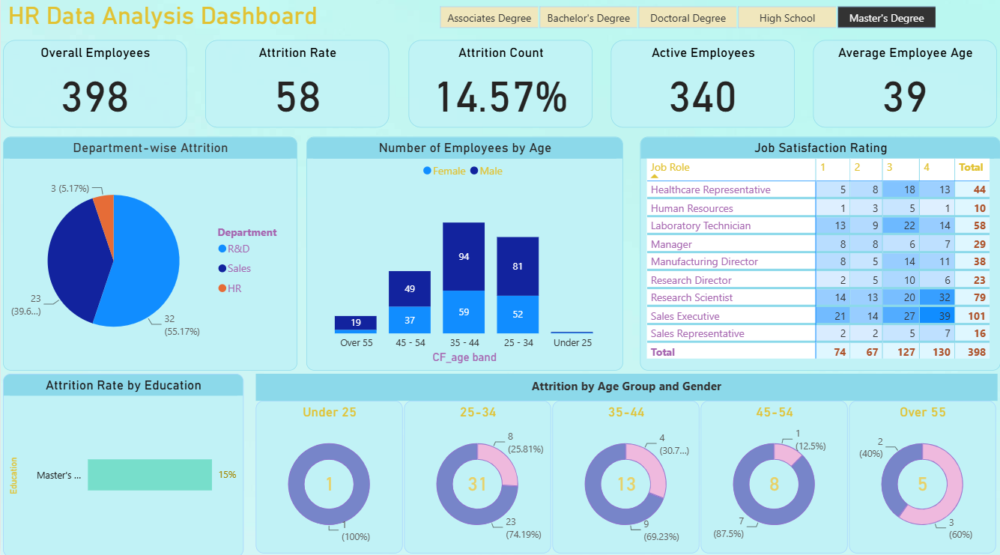

# HR Analytics – Employee Attrition Analysis



## Project Overview

This project uses Microsoft Power BI to analyze employee attrition and explore workforce trends. The interactive dashboard provides an overview of employee demographics, attrition rates, department distribution, and job satisfaction to support data-driven HR decisions.

## Key Performance Indicators

| KPI | Value |
|---|---:|
| Total Employees | 1,470 |
| Attrition Count | 237 |
| Active Employees | 1,233 |
| Attrition Rate | 16.12% |
| Average Employee Age | 37 |

## Dashboard Features

- Workforce overview through key performance indicators.
- Employee distribution by age group and gender.
- Attrition analysis across departments.
- Employee attrition by gender.
- Job satisfaction ratings across different job roles.
- Interactive department filtering.

## Business Insights

Based on the dashboard analysis:

- The overall employee attrition rate is 16.12%.
- Research & Development accounts for the largest share of employee attrition (56.12%).
- Sales represents 38.82% of attrition, while Human Resources accounts for 5.06%.
- The workforce is distributed across different age groups and genders.
- Job satisfaction ratings vary across different job roles.

## Tools & Skills

- Microsoft Power BI
- Data Visualization
- HR Analytics
- Dashboard Development
- KPI Analysis
- Workforce Analysis
- Business Insights

## Business Recommendations

- Investigate the factors contributing to higher attrition in Research & Development and Sales.
- Review employee satisfaction levels across different job roles.
- Develop targeted employee retention strategies for departments with higher attrition.
- Monitor attrition patterns across age groups and genders to identify areas that may require further investigation.

## Project Structure

```text
HR-Analytics-Employee-Attrition-Analysis/
│
├── HR-Analytics-Employee-Attrition-Analysis.pbix
├── Dashboard-Overview.png
└── README.md
```

---

# تحليل الموارد البشرية – تحليل مغادرة الموظفين

## نبذة عن المشروع

يهدف هذا المشروع إلى تحليل بيانات الموارد البشرية باستخدام Microsoft Power BI، مع التركيز على مغادرة الموظفين ودراسة اتجاهات القوى العاملة.

توفر لوحة المعلومات نظرة شاملة على أعداد الموظفين ومعدلات المغادرة، والخصائص الديموغرافية، وتوزيع المغادرة حسب الأقسام، ومستويات الرضا الوظيفي.

## مؤشرات الأداء الرئيسية

| المؤشر | القيمة |
|---|---:|
| إجمالي الموظفين | 1,470 |
| عدد الموظفين المغادرين | 237 |
| الموظفون النشطون | 1,233 |
| معدل المغادرة | 16.12% |
| متوسط عمر الموظفين | 37 |

## أبرز التحليلات

- نظرة عامة على القوى العاملة ومؤشرات الأداء الرئيسية.
- توزيع الموظفين حسب الفئات العمرية والجنس.
- تحليل مغادرة الموظفين حسب الأقسام.
- تحليل المغادرة حسب الجنس.
- تقييم مستويات الرضا الوظيفي حسب المسميات الوظيفية.
- إمكانية تصفية البيانات حسب القسم.

## أهم النتائج

- بلغ معدل مغادرة الموظفين 16.12%.
- يمثل قسم البحث والتطوير النسبة الأكبر من مغادرة الموظفين بنسبة 56.12%.
- يمثل قسم المبيعات 38.82% من المغادرة، بينما يمثل قسم الموارد البشرية 5.06%.
- تتوزع القوى العاملة على فئات عمرية وجنسية مختلفة.
- تختلف تقييمات الرضا الوظيفي بين المسميات الوظيفية.

## التوصيات

- دراسة أسباب ارتفاع مغادرة الموظفين في قسمي البحث والتطوير والمبيعات.
- مراجعة مستويات الرضا الوظيفي حسب المسميات الوظيفية.
- وضع استراتيجيات للاحتفاظ بالموظفين في الأقسام ذات معدلات المغادرة الأعلى.
- متابعة أنماط المغادرة حسب العمر والجنس لتحديد الجوانب التي تحتاج إلى دراسة إضافية.

## الأدوات والمهارات

- Microsoft Power BI
- تحليل البيانات وتصويرها
- تحليل الموارد البشرية
- تصميم لوحات المعلومات
- تحليل مؤشرات الأداء
- تحليل القوى العاملة
- استخراج رؤى الأعمال
